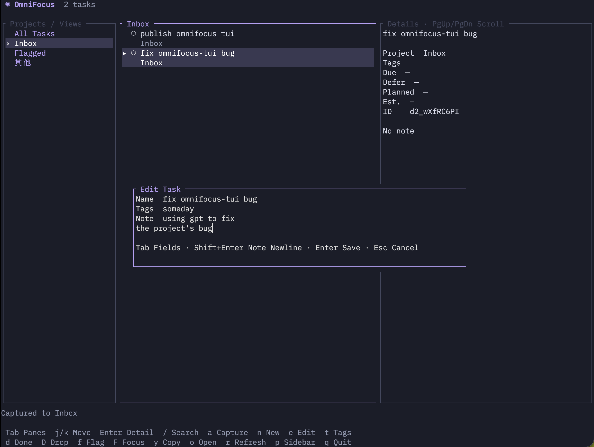

# OmniFocus TUI

[](https://github.com/Tomyail/omnifocus-tui/actions/workflows/ci.yml)

[English](README.md)

macOS 上的 OmniFocus 终端界面，使用 Rust + Ratatui，通过 [omnifocus-cli](https://github.com/stephendolan/omnifocus-cli) 直接读写 OmniFocus 数据库——无需同步，没有本地副本，也不会改动系统里的其他东西。



## 快速开始

**前置条件**：一台装有 [OmniFocus](https://www.omnigroup.com/omnifocus/) 的 Mac。

**1.** 安装 `of` CLI（需要 [Bun](https://bun.sh)）：

```sh
curl -fsSL https://bun.sh/install | bash   # 已装过 Bun 可跳过
bun install -g @stephendolan/omnifocus-cli
```

**2.** 一行安装 omnifocus-tui，无需 Rust 工具链：

```sh
curl -fsSL https://raw.githubusercontent.com/Tomyail/omnifocus-tui/main/install.sh | sh
```

**3.** 在任意终端运行：

```sh
omnifocus-tui
```

以后升级只需一条命令：`omnifocus-tui update`。启动时程序也会在后台检查新版本（每天最多一次）并安装，下次启动生效；在配置文件里设置 `auto_update = false` 可关闭。

### 首次启动

macOS 会弹窗询问一次自动化 OmniFocus 的权限——点**允许**，再按 `r` 刷新即可。设置到此结束。

30 秒上手：

| 按键 | 作用 |
| --- | --- |
| `j` / `k` | 移动选择 |
| `a` | 收集一条想法到 Inbox |
| `Enter` | 查看任务详情 |
| `q` | 退出 |

底部状态栏始终显示当前可用的按键，不会迷路。鼠标点选和滚轮也都支持。

## 操作（默认按键）

| 按键 | 操作 |
| --- | --- |
| ↑↓ / j k | 移动选择 |
| Tab / h / l | 切换项目栏与任务栏 |
| Enter | 展开或收起任务详情 |
| PgUp / PgDn | 滚动详情 |
| / | 搜索当前视图 |
| a / + | 收集到 Inbox |
| n | 新建任务：项目视图下进当前项目，否则进收件箱 |
| e | 编辑名称、标签与备注——Tab 切换字段，Enter 保存，Esc 取消 |
| f | 切换旗标 |
| t | 直接定位到标签字段 |
| d | 完成任务（需确认） |
| D | 删除任务（需确认；可在 OmniFocus 中恢复） |
| F | 聚焦任务所在项目——侧栏只保留该项目，再按 F 或 Esc 取消 |
| y | 复制任务的标题、ID、链接和备注 |
| o | 在 OmniFocus 中打开任务 |
| r | 刷新 |
| p | 显示或隐藏项目栏 |
| q / Esc | 清除搜索、取消聚焦、关闭详情或退出 |

所有按键都可在配置文件中修改——见[按键配置（英文）](docs/keybindings.md)。

值得知道：

- 启动时默认进入 Inbox，侧栏后续为旗标和项目视图。
- 列表每 30 秒自动刷新；操作在后台执行。
- 收集、新建、旗标、标签和编辑直接写入 OmniFocus；完成和删除会先请求确认。
- 收集成功后自动切换到 Inbox 并选中新任务。

## 配置

可选配置文件 `~/.config/omnifocus-tui/config.toml`：

```toml
language = "zh"   # 界面语言：zh（默认）或 en

[keys]
capture = ["a", "+"]   # 任意动作都可改键
```

完整的动作列表、按键写法与校验规则见[按键配置（英文）](docs/keybindings.md)。

## herdr（可选）

在用 [herdr](https://herdr.dev)？装成插件，一键全屏弹出：

```sh
herdr plugin install Tomyail/omnifocus-tui
```

键位设置与其他动作见 [herdr 集成（英文）](docs/herdr.md)。

## 卸载

```sh
curl -fsSL https://raw.githubusercontent.com/Tomyail/omnifocus-tui/main/uninstall.sh | sh -s -- --purge
```

不加 `--purge` 则保留 `~/.config/omnifocus-tui` 里的配置文件。

## 开发

```sh
cargo run                                          # 源码运行
cargo test && cargo clippy --all-targets -- -D warnings
```

常用参数：`--check` 只读检查连接、`--capture` 快速收集后退出、`--keys` 打印终端上报的按键事件；`omnifocus-tui update` 下载最新 release 并原地替换二进制。程序在 PATH 和 `~/.bun/bin` 里查找 `of`，可用 `OMNIFOCUS_CLI` 指定路径。

## 文档

- [按键配置与改键](docs/keybindings.md)（英文）——全部动作、按键写法、冲突规则
- [herdr 集成](docs/herdr.md)（英文）——弹窗、分屏、标签页动作与本地开发
